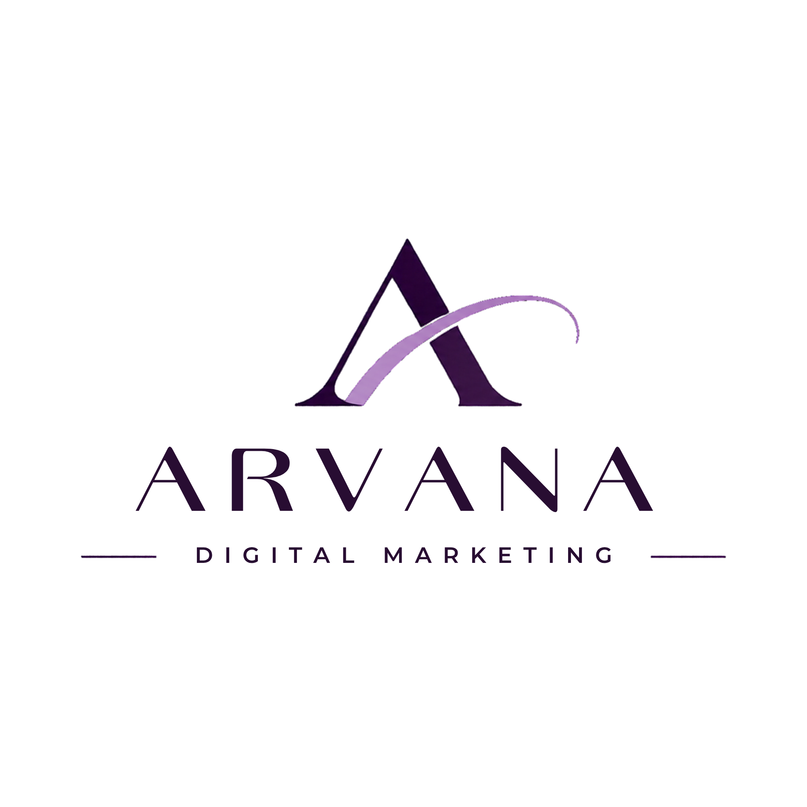

<!DOCTYPE html>
<html lang="ro">
<head>
<meta charset="UTF-8">
<meta name="viewport" content="width=device-width, initial-scale=1.0">
<meta name="theme-color" content="#302044">
<meta name="description" content="ARVANA Brand & Marketing Audit — evaluează fundația brandului și a activităților tale de marketing.">
<title>ARVANA | Brand & Marketing Audit</title>

<link rel="preconnect" href="https://fonts.googleapis.com">
<link rel="preconnect" href="https://fonts.gstatic.com" crossorigin>
<link href="https://fonts.googleapis.com/css2?family=DM+Sans:wght@400;500;600;700;800&family=Lora:ital,wght@0,400;0,500;0,600;0,700;1,400;1,500&display=swap" rel="stylesheet">

</head>

<body>

  

  

  

<header class="header">
  
  

    Strategic Marketing & Brand Development
  

</header>

<!-- HOME PAGE MOV -->

<section class="hero">
  

    
ARVANA · BRAND & MARKETING AUDIT

    <h1>
      Înțelege-ți 
      businessul. 
      Construiește cu direcție.
    </h1>
    

      Un brand puternic începe cu o înțelegere clară a propriei activități.
      Atunci când știi ce oferi, cui te adresezi și ce te diferențiază,
      poți lua decizii mai bune și poți construi o comunicare care are sens.
      Descoperă cât de bine este conturată fundația brandului și a marketingului tău.
    

    
Un instrument gratuit pentru businessul tău

  

</section>

<!-- INTRO PANEL -->

<section class="intro-wrap">
  

    

      

        
O perspectivă mai clară

        <h2>Începe cu o perspectivă mai clară.</h2>
        

          Evaluează fundația brandului și a activităților tale de marketing.
          Răspunde sincer, în funcție de situația actuală a businessului.
          Nu există răspunsuri corecte sau greșite. Important este să privești
          obiectiv modul în care funcționează astăzi activitatea ta.
        

      

    

  

</section>

<!-- FEATURE BOXES -->

<section class="section">
  

    

      
Ce vei descoperi

      <h2>O imagine de ansamblu asupra brandului tău.</h2>
      

        Evaluarea analizează șase perspective esențiale ale dezvoltării
        unui business, reunite în cinci dimensiuni de evaluare.
      

    

    

      <article class="feature-box light reveal">
        
01

        <h3>Poziționare</h3>
        
Cât de bine îți cunoști publicul, oferta, valoarea pe care o aduci și diferențele care te fac relevant în piață?

        

      </article>

      <article class="feature-box dark reveal">
        
02

        <h3>Identitate de brand</h3>
        
Identitatea vizuală, personalitatea și experiența oferită transmit aceeași imagine și aceleași valori?

        

      </article>

      <article class="feature-box light reveal">
        
03

        <h3>Comunicare</h3>
        
Mesajele tale sunt clare, consecvente și relevante pentru oamenii cărora dorești să te adresezi?

        

      </article>

      <article class="feature-box dark reveal">
        
04

        <h3>Strategie de conținut</h3>
        
Conținutul este construit în jurul unor obiective și direcții clare sau publici fără un plan bine definit?

        

      </article>

      <article class="feature-box light reveal">
        
05

        <h3>Strategie de marketing</h3>
        
Ai obiective măsurabile, alegi canalele potrivite și urmărești rezultatele acțiunilor tale?

        

      </article>

      <article class="feature-box dark reveal">
        
06

        <h3>Direcție și dezvoltare</h3>
        
Deciziile de marketing sunt conectate la obiectivele businessului și susțin dezvoltarea sa pe termen lung?

        

      </article>
    

  

</section>

<!-- AUDIT INTRODUCTION -->

<section class="audit-intro">
  

    

      
Primul pas către o direcție mai bună

      <h2>Descoperă unde te afli acum.</h2>
      

        Răspunde la 15 întrebări despre modul în care îți construiești
        brandul și îți desfășori activitățile de marketing.
        La final vei primi un scor orientativ, o evaluare pe fiecare
        dimensiune și recomandări pentru zonele care merită atenția ta.
      

      

        <button class="primary-btn" id="startBtn" type="button" onclick="startAudit()">
          Începe evaluarea →
        </button>
      

      

        15 întrebări · Aproximativ 5–7 minute · Gratuit
      

    

  

</section>

<!-- AUDIT QUESTIONS -->

<section class="audit-area" id="auditArea">
  

    

      

        Progresul evaluării
        0 din 15
      

      

        

      

    

    

      
Evaluarea ARVANA

      <h2>Răspunde cu sinceritate.</h2>
      
Alege varianta care descrie cel mai bine situația actuală a businessului tău.

    

    

  

</section>

<!-- RESULTS -->

<section class="results" id="results">
  

    

      
ARVANA · Rezultatul evaluării

      <h2>O perspectivă asupra brandului tău.</h2>
      
Acesta este punctul de plecare pentru decizii mai clare și o dezvoltare mai coerentă.

    

    

      

        

          <svg class="score-svg" viewBox="0 0 180 180" role="img" aria-label="Graficul scorului general">
            <circle class="score-track" cx="90" cy="90" r="78"/>
            <circle class="score-progress" id="scoreArc" cx="90" cy="90" r="78"/>
          </svg>
          

            0
            din 100 puncte
          

        

        

          <h3 id="scoreTitle">Rezultatul tău</h3>
          

          

        

      

    

    

      <h3 class="result-section-title">Evaluarea pe dimensiuni</h3>
      

    

    

      <h3 class="result-section-title">Ce îți spune rezultatul?</h3>
      

    

    

      <h3 class="result-section-title">Direcții de îmbunătățire</h3>
      

        Aceste recomandări sunt orientative și se bazează pe răspunsurile tale.
      

      

    

    <section class="professional-section reveal">
      
Dincolo de evaluare

      <h3>Uneori, următorul pas este să privești businessul dintr-o perspectivă nouă.</h3>
      

        Un instrument de autoevaluare te poate ajuta să identifici anumite
        aspecte ale activității tale. Totuși, un rezultat nu surprinde
        întotdeauna toate provocările, oportunitățile sau particularitățile
        unui business.
      

      

        O discuție cu un profesionist în marketing
        poate aduce claritate asupra poziționării, identității de brand,
        comunicării și direcției de dezvoltare. Împreună, aceste elemente
        pot fi analizate în contextul real al activității tale și transformate
        într-o direcție de acțiune adaptată obiectivelor businessului.
      

      

        La ARVANA, abordarea pornește de la înțelegerea businessului,
        continuă cu strategia și se concretizează în decizii de brand
        și comunicare cu un scop clar.
      

      

        <a class="primary-btn" href="https://marianapastean.my.canva.site/mariana-pastean-portfolio" target="_blank" rel="noopener">
          Descoperă portofoliul ARVANA →
        </a>
      

    </section>

    

      <button class="primary-btn" type="button" onclick="downloadPDF()">Salvează raportul PDF</button>
      <button class="secondary-btn" type="button" onclick="copyReport()">Copiază rezultatul</button>
      <button class="secondary-btn" type="button" onclick="restartAudit()">Reia evaluarea</button>
    

    

      ARVANA BRAND & MARKETING AUDIT este un instrument gratuit de
      autoevaluare orientativă. Rezultatul se bazează exclusiv pe
      răspunsurile oferite și nu reprezintă un audit profesional,
      o analiză de piață sau o garanție a performanței businessului.
      Recomandările au caracter informativ.
    

  

</section>

<footer class="footer">
  
ARVANA

  
DIGITAL MARKETING

  
Direcție clară. Branduri cu valoare.

  <a class="footer-link" href="https://marianapastean.my.canva.site/mariana-pastean-portfolio" target="_blank" rel="noopener">
    Explorează portofoliul
  </a>
  

    ARVANA Digital Marketing · Strategic Marketing & Brand Development 
    ©  ARVANA. Toate drepturile rezervate.
  

</footer>

</body>
</html>
